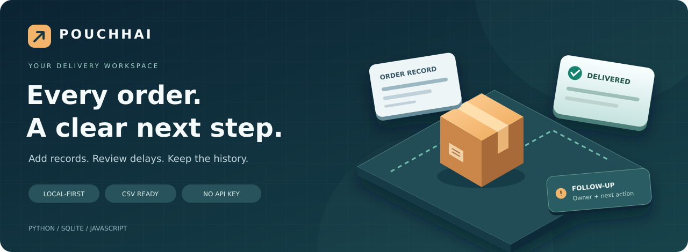
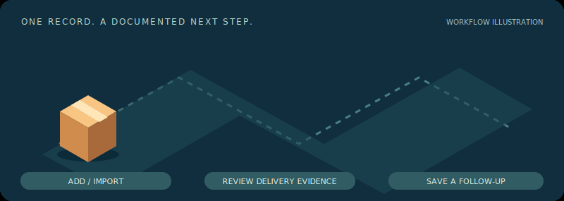
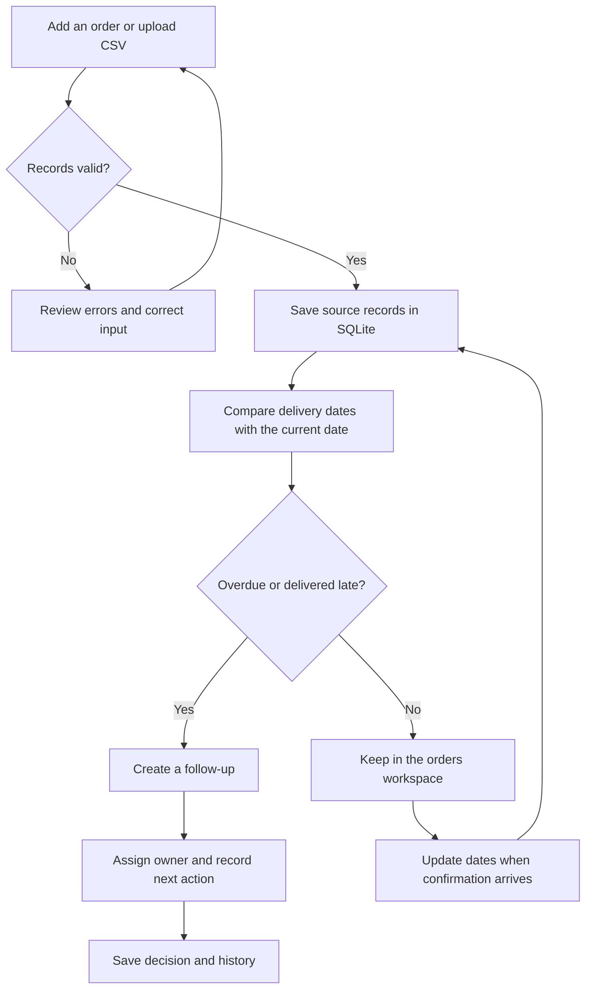
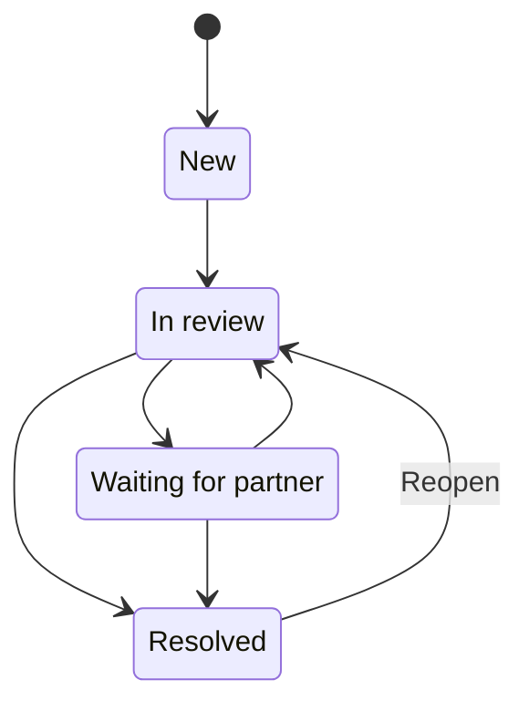

<div align="center">



# পৌঁছাই / Pouchhai

### A clearer view of deliveries. A documented next step.

A local workspace for small shops and operations teams to add orders, review delays,<br>
update confirmed delivery dates and keep follow-ups together.

<p>
  
  
  
  
  
</p>

[Quick start](#quick-start) · [Features](#features) · [Workflow](#workflow) · [Import data](#import-your-orders) · [Verification](#verification)

</div>

---

## Why Pouchhai?

Delivery evidence often sits in a ledger or spreadsheet, while the next action lives somewhere else. Pouchhai brings the order, its expected date, confirmed delivery events and follow-up history into one workspace.

**Start with your own records.** Identify what needs attention, assign a next step and retain the reason behind each decision.

> **How updates work:** Pouchhai uses your entries and CSV imports. It recalculates delays using the current Bangladesh date and refreshes saved records every 30 seconds. External courier tracking is not connected.

## Features

<table>
<tr>
<td width="33%" valign="top">

### 01 · Bring your records

Add one order or preview a CSV before importing. Validate dates and IDs, with no silent overwrites.

</td>
<td width="33%" valign="top">

### 02 · See what needs attention

Find overdue or delivered-late orders. Search, filter and inspect the dates behind each status.

</td>
<td width="33%" valign="top">

### 03 · Keep the next step clear

Assign an owner and priority. Save a note, close or reopen a follow-up, and retain its history.

</td>
</tr>
</table>

| Capability | What it gives you |
|---|---|
| **Order workspace** | Order IDs, destinations, source references and confirmed dates in one place |
| **CSV check and preview** | Row-level feedback before an all-or-nothing import |
| **Current-date classification** | On schedule, overdue, delivered on time or delivered late |
| **Evidence timeline** | Order, expected, dispatch and delivery dates together |
| **Source corrections** | Update delivery facts with a reason and a preserved change history |
| **Follow-up queue** | An accountable owner, explicit priority and documented decisions |
| **Stale-write protection** | Conflicting edits cannot silently replace a newer version |
| **Local persistence** | Records remain after refresh or restart; CSV exports are available |
| **Separate demo mode** | Explore real historical Olist orders without mixing them with your records |

<details>
<summary><strong>View the animated workflow illustration</strong></summary>

<br>


*Decorative workflow illustration—not a recording of the app or live operational data.*

</details>

## Quick start

**Requirements:** Python 3.10+ and a modern browser. No pip installation, API key or internet connection is needed to run the app.

Open a terminal in the project folder:

```bash
python app.py --open
```

Windows Python launcher:

```powershell
py app.py --open
```

Open **[http://127.0.0.1:8765](http://127.0.0.1:8765)** if the browser does not open automatically. Stop the app with **Ctrl+C**.

<details>
<summary>Port already in use?</summary>

```bash
python app.py --port 8766 --open
```

Then open the address printed in the terminal.

</details>

### Your first order

1. Keep **Data source → My orders** selected.
2. Click **Add order** and enter the ID, city, order date and expected delivery date from your source record.
3. Leave dispatch or delivery dates blank until confirmed.
4. Use **Update order / delivery** when new evidence arrives; record the reason for the change.
5. Review delayed orders in **Follow-ups**, assign an owner and document the next step.

**My orders starts empty.** Demo records are never inserted into your own workspace.

## Workflow



<details>
<summary><strong>Follow-up state transitions</strong></summary>



- Moving past **New** requires an assigned owner.
- Every save needs a note of 3–1,000 characters.
- **Resolved** requires a resolution reason.
- Reopening clears the active resolution while preserving the earlier decision.
- Updating a delivery date does not automatically close its follow-up.

</details>

## Import your orders

Click **Import CSV → Download blank CSV template**, or open [data/import_template.csv](data/import_template.csv).

```csv
order_id,city,area,order_date,expected_delivery_date,dispatched_date,delivered_date,source_reference
```

| Column | Required | Format / purpose |
|---|:---:|---|
| `order_id` | Yes | Unique order identifier |
| `city` | Yes | Destination city |
| `area` | No | Area or district |
| `order_date` | Yes | `YYYY-MM-DD` |
| `expected_delivery_date` | Yes | `YYYY-MM-DD` |
| `dispatched_date` | No | Confirmed dispatch date |
| `delivered_date` | No | Confirmed delivery date |
| `source_reference` | No | Ledger or consignment reference |

**Choose file → Check file → Review preview → Import orders.**

- UTF-8 CSV, including a BOM; maximum **500 records / 1 MB** per import.
- Any invalid row prevents the entire batch from being saved.
- Duplicate IDs do not overwrite records. Update an existing order individually.
- Actual event dates cannot be in the future or precede the order date; delivery cannot precede recorded dispatch.
- Additional columns are ignored. Map the source into the template first.

<details>
<summary><strong>How delay is calculated</strong></summary>

| Situation | Result |
|---|---|
| Not delivered; expected today or later | **On schedule** |
| Not delivered; expected date has passed | **Overdue** |
| Delivered on or before the expected date | **On time** |
| Delivered after the expected date | **Delivered late** |

Delay uses calendar dates. For an undelivered order it compares today's Bangladesh date with the expected date. For a delivered order it compares the actual and expected delivery dates.

This is not a working-day or contractual SLA calculator. A missing delivery date may mean the record needs updating; it does not prove the shipment is lost.

</details>

## Two workspaces, clearly separated

| | My orders | Demo data · Olist |
|---|---|---|
| **Source** | Your entries and CSV imports | Real historical Brazilian ecommerce data |
| **Initial records** | Empty | 120 selected orders |
| **Date reference** | Current Bangladesh date, UTC+6 | Fixed snapshot: 31 August 2018 |
| **Source updates** | Add and correct your records | Historical source records are read-only |
| **Follow-up history** | Your operational decisions | Separate demonstration decisions |

Demo data comes from [Olist's Brazilian E-Commerce Public Dataset](https://www.kaggle.com/datasets/olistbr/brazilian-ecommerce), under **CC BY-NC-SA 4.0**. Attribution and transformations are documented in [data/README.md](data/README.md); source hashes and selection details are in [data/provenance.json](data/provenance.json).

The demo deliberately includes many exceptions. Its percentages are not population performance estimates. Raw Kaggle files need the provided preparation step; they are not a direct replacement for the own-order import template.

<details>
<summary>Rebuild the historical demo from the official Kaggle ZIP</summary>

Stop the app, then run:

```bash
python prepare_data.py "path/to/brazilian-ecommerce.zip"
```

This regenerates the historical demo CSV and provenance. It does not import those rows into My orders.

</details>

## A short walkthrough

For a practical demonstration, show:

**Import preview → delivery-status filters → source timeline → delivery update → follow-up decision → activity history → refresh.**

Use records you are authorised to handle. Label invented records as practice data. For a historical walkthrough, select the separate Olist demo.

<!-- Add your own demo recording here after uploading it to GitHub.
Paste the actual uploaded video URL, or add a Markdown link to the recording.
Do not leave a placeholder URL or describe an illustration as an app recording.
-->

## Data, persistence and backup

Records and decisions are saved in **`data/reviews.sqlite3`**. Source corrections and follow-up changes retain their history. Export orders or follow-up summaries from the workspace footer.

For a complete backup, **stop the app and copy the SQLite file**. Restore it only while the app is stopped. CSV exports are spreadsheet-safe summaries, not complete database backups; formula-like text may receive a leading apostrophe.

The server binds to localhost. This version is intended for local, single-user use and does not provide authentication or cloud backup. Customer names, phone numbers and full addresses are not required.

## Verification

```bash
python -m unittest discover -s tests -v
```

**28 backend tests passed in the validated build.** This is a recorded local result, not a live CI badge. Coverage includes date rules, duplicate protection, preview/no-write, atomic import, source corrections, stale edits, persistence, export and separation between workspaces.

Chromium checks also exercised adding an order, updating delivery dates, CSV import, follow-up closure, reload persistence, mobile layout and the actual 30-second local refresh timer. Details and optional browser-test commands are in [release notes](docs/RELEASE_NOTES.md).

Tests use temporary fixtures. No merchant pilot or measured reduction in delivery delays is claimed.

## Project map

| Path | Responsibility |
|---|---|
| [`app.py`](app.py) | Local HTTP API, follow-up workflow and persistence |
| [`live.py`](live.py) | Order validation, classification, CSV ingestion and source history |
| [`web/`](web/) | Responsive HTML/CSS/JavaScript interface and offline Bangla font |
| [`data/`](data/) | Blank import template, separate demo sample and attribution |
| [`prepare_data.py`](prepare_data.py) | Reproduce the Olist historical sample |
| [`tests/`](tests/) | Backend regression tests and optional browser acceptance checks |

## Documentation

[Business scope](docs/BUSINESS_BRIEF.md) · [Requirements](docs/REQUIREMENTS.md) · [Acceptance checks](docs/UAT_TRACEABILITY.md) · [Release notes](docs/RELEASE_NOTES.md)

## Scope and next validation

External courier tracking, cancellations, returns, refunds, COD reconciliation and working-day deadlines are outside this version. The next useful evaluation is to run authorised source records through the workflow and compare the results with those sources.

## License and credits

Application code: **MIT**. The Olist demo data retains **CC BY-NC-SA 4.0** terms; the bundled Bangla font has its own license. See [LICENSE.md](LICENSE.md).

Developed with AI assistance. No external organisation endorsement is implied. The README's isometric artwork and animation are illustrative repository assets, not screenshots or live data.
